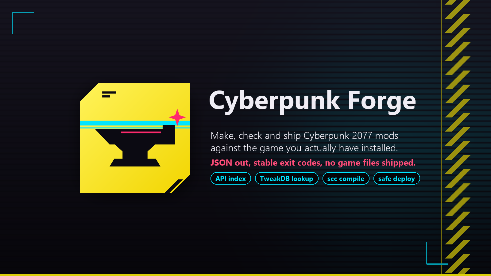
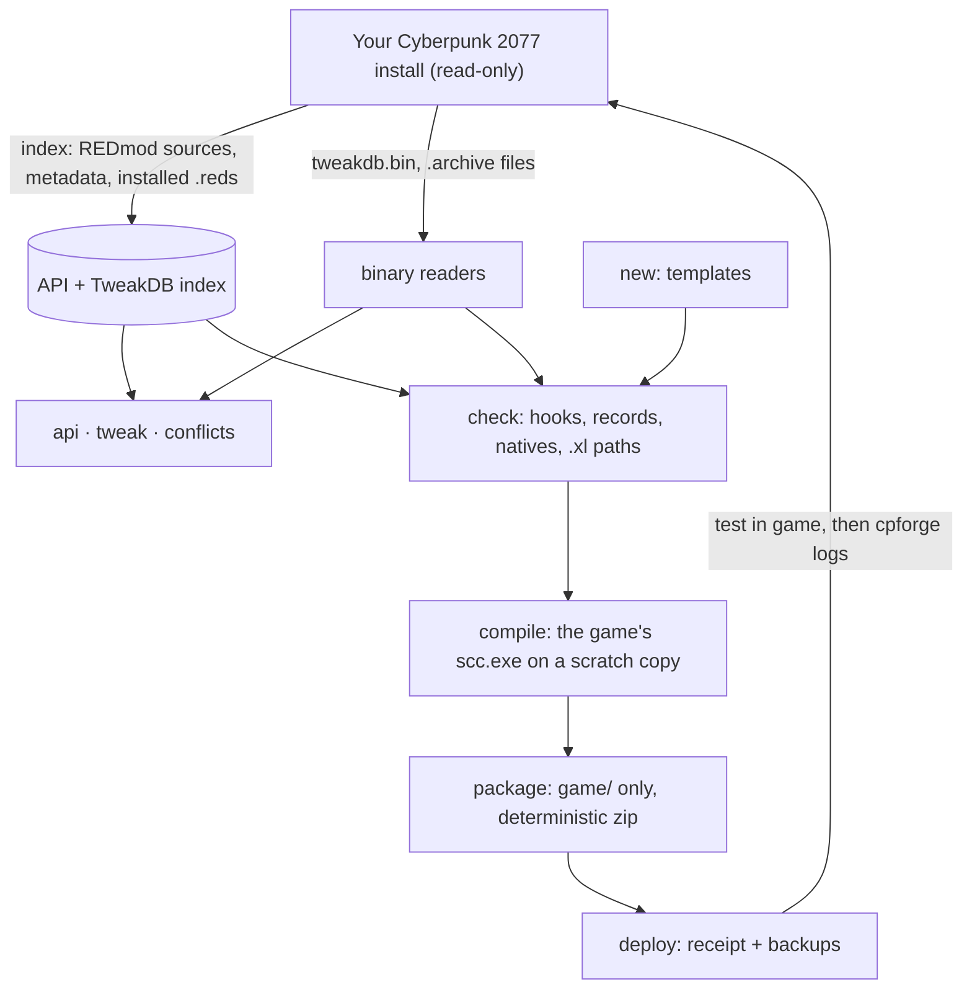

<div align="center">



[](https://github.com/SenjuWoo/Cyberpunk-Forge/actions/workflows/ci.yml)
[](https://github.com/SenjuWoo/Cyberpunk-Forge/releases)
[](pyproject.toml)
[](pyproject.toml)
[](LICENSE)

**[Install](#install)** · **[Tour](#a-typical-loop)** · **[Commands](#commands)** · **[Templates](#templates)** · **[How it works](#how-it-works)** · **[Changelog](CHANGELOG.md)**

</div>

Cyberpunk Forge is a command-line toolkit for making, checking, fixing and
shipping **Cyberpunk 2077** mods: redscript, Cyber Engine Tweaks (Lua),
TweakXL, ArchiveXL, RED4ext (C++), Input Loader, Mod Settings, Audioware and
REDmod. It reads classes, methods, TweakDB records and archive contents from
**the game you have installed**, so a hook or record name is checked against
your patch before the game ever starts.

It comes with an agent skill (`skills/cyberpunk-forge/SKILL.md`) and works
offline. It never downloads mods, never uploads, and writes to the game folder
only when you run `cpforge deploy`.

## What you get

- **Names you don't have to guess.** `api` looks up classes, methods, fields and enums from the game's own script sources and the installed `.reds` files. `tweak` finds TweakDB records and shows their vanilla `.tweak` source. `archive find` tells you which archive holds a resource.
- **Checks before you launch.** `check` verifies redscript hook targets, TweakXL `.yaml` and `.tweak` records and references, calls to natives that only another mod declares, `.archive.xl` paths and version mirrors. `check --compile` runs the game's own `scc.exe` on a scratch copy and maps errors back to your file and line.
- **Patch-day answers.** `api versions` and `api diff <old> <new> --project .` list what a game patch removed or changed and which of your hooks it breaks (it needs an index of both patches).
- **Templates that compile.** Nine kinds of starting project (redscript, Mod Settings, CET, TweakXL, ArchiveXL, Input Loader, RED4ext, Audioware, REDmod) that can be combined in one mod.
- **Safe test installs.** `deploy` writes a receipt, backs up whatever it replaces and never writes through a mod manager's hard links. `undeploy` puts the files back.
- **Release kit.** `package` makes a deterministic zip with a SHA-256 and a receipt. `validate` checks any mod zip for layout mistakes, dev files and leaked API keys. `bump` moves the version everywhere and keeps the last good zip, and `nexus` writes the page text.
- **JSON everywhere.** Every command prints one JSON object and exits with a stable code: 0 ok, 1 findings, 2 a named failure with a `fix`, 3 a forge bug. People can read it, and scripts and agents can parse it.


## Install

Requirements: Windows 10/11 with the game installed, and Python 3.10+.
Optional, and `doctor` tells you which ones it found:

| Tool | Unlocks |
|---|---|
| The free **REDmod** DLC | vanilla script and TweakDB sources for the index (`api`, `tweak show`, hook checks) |
| [WolvenKit CLI](https://github.com/WolvenKit/WolvenKit) | packing `.archive` files (`build`) and `res roundtrip` |
| CMake + Visual Studio Build Tools | building RED4ext plugins (`build`) |
| luajit, luac5.1 or luac | Lua syntax checks for CET mods |

Download the source zip from the [latest release](https://github.com/SenjuWoo/Cyberpunk-Forge/releases/latest), extract it and run `START-HERE.bat`. Or from a shell:

```powershell
git clone https://github.com/SenjuWoo/Cyberpunk-Forge
cd Cyberpunk-Forge
powershell -ExecutionPolicy Bypass -File Install.ps1
```

The installer creates a `.venv` in that folder, runs the tests, adds a
`cpforge` launcher to your user PATH and copies the agent skill into the agent
skill folders it finds. An existing copy is backed up first, under
`%LOCALAPPDATA%\CyberpunkForge\skill-backup`. `-SkipTests`, `-DryRun` and
`-NoAgentIntegration` do what they say. `Uninstall.ps1` reverses it. To run
without installing, use `cpforge.cmd <command>` from the folder.

Then:

```bat
cpforge doctor
cpforge index
```

`index` reads your game once per patch (about 40 seconds on 2.5) and stores the
result under `%LOCALAPPDATA%\CyberpunkForge`. If the game is not found, pass
`--game "<folder with bin\x64\Cyberpunk2077.exe>"` or set `CP2077_ROOT`.

## A typical loop

```bat
cpforge plan "make enemies drop more ammo"
cpforge new "More Ammo" --kind tweakxl
cd MoreAmmo
cpforge tweak search ammo loot
cpforge check
cpforge deploy        & rem then test in game
cpforge logs --mod MoreAmmo
cpforge undeploy
cpforge package
cpforge nexus
```


## Commands

Every command takes `--game <folder>`. `cpforge capabilities` prints all 26
commands and their options as JSON, generated from the parser.

| Need | Command |
|---|---|
| Health: CLI, payload, game, frameworks, index, tools | `cpforge doctor [--require-game]` |
| Route an idea to a surface, templates, docs and steps | `cpforge plan "add a new jacket to a vendor"` |
| Knowledge docs and versioned facts with sources | `cpforge knowledge [name]` · `cpforge facts [key]` |
| Game version, frameworks and installed mods | `cpforge game` |
| Build the local API and TweakDB index | `cpforge index [--vanilla-only]` |
| Classes, functions, fields, enums | `cpforge api search OnAction` · `api class PlayerPuppet --filter Attached` · `api enum <Name>` |
| What a patch changed, which of your hooks it breaks | `cpforge api versions` · `api diff 2.31 2.5 --project .` |
| TweakDB records | `cpforge tweak search lexington` · `tweak show Items.Preset_Lexington_Default` · `tweak exists A,B` |
| Meshes, appearances, entities (WolvenKit JSON) | `cpforge res check\|inspect\|roundtrip <files>` |
| Archive index, or which archive holds a resource | `cpforge archive info <file.archive>` · `archive find <resource path> --vanilla` |
| Resource-path and TweakDB hashes | `cpforge hash <path>` · `hash --tweakdb <Record>` |
| Mods fighting over hooks, resources or records | `cpforge conflicts [--what scripts\|archives\|tweaks]` |
| All mod logs at once (redscript, RED4ext, CET, ArchiveXL, TweakXL, Codeware, crash reports) | `cpforge logs [--mod <name>]` |
| Match an error message against known errors | `cpforge explain "<error text>"` |
| Templates and new projects | `cpforge templates` · `cpforge new "My Mod" --kind redscript --kind modsettings` |
| Validate against the installed game | `cpforge check [--compile]` |
| Compile redscript with the game's scc.exe | `cpforge compile [--deps auto\|none\|all\|A,B] [--keep <dir>]` |
| Build a RED4ext plugin (CMake) or pack an archive (WolvenKit CLI) | `cpforge build [--config Release\|Debug\|RelWithDebInfo]` |
| Release zip, any zip check | `cpforge package` · `cpforge validate mod.zip` |
| Test install and removal | `cpforge deploy [--dry-run] [--force]` · `cpforge undeploy [--dry-run]` |
| Version and Nexus page | `cpforge bump major\|minor\|patch\|X.Y.Z` · `cpforge nexus` |


## Templates

| Kind | What you get |
|---|---|
| `redscript` | module + a `@wrapMethod` hook on `PlayerPuppet.OnGameAttached` |
| `modsettings` | a Mod Settings menu on a `ScriptableSystem` (toggle + slider) |
| `cet` | CET `init.lua` with an ImGui window and a hotkey |
| `tweakxl` | TweakXL YAML with a cloned record |
| `archivexl` | `.archive.xl` (factory + localization) and the item record; resources go in `source/archive/` |
| `input` | Input Loader XML (context, action, rebindable key) + redscript listener |
| `red4ext` | C++20 CMake plugin on the RED4ext SDK v1 API, pinned to the SDK commit for game 2.5 |
| `audioware` | Audioware manifest and a placeholder sound |
| `redmod` | REDmod `info.json` package |

Kinds combine: `cpforge new "My Mod" --kind redscript --kind cet --kind tweakxl`.
The redscript templates compile against the 2.5 script bundle, and CI builds
the RED4ext template on Windows.

A project looks like this:

```text
cpforge.json   manifest: name, id, version, kinds, requirements, version files
game/          files at their game-relative paths (what ships)
source/        what builds into game/ (C++ plugin, WolvenKit resources)
CHANGELOG.md   per-version notes (feeds the Nexus kit; never packaged)
dist/          zips, checksums, receipts, Nexus kit
```

## How it works



- **Facts are data with sources.** Formats, versions and layouts live in `src/cpforge/knowledge/facts.json`, each tagged with how it was established. Framework markers, task routes and known log errors are versioned JSON next to it, and 18 knowledge docs ship with the tool (`cpforge knowledge`).
- **The index stays on your machine.** It is built from your own install under `%LOCALAPPDATA%\CyberpunkForge`, one per game version, so `api diff` can compare patches. No game files are in this repository or in its releases.
- **Evidence tiers stay separate.** `check` reports what it checked, what it could not check and why (`gaps`). A static check or a clean compile is not a runtime test, and the forge never claims one is. Load the game to prove behaviour.

## Tested

`python tests/run_tests.py` runs the offline suite against a fake game tree on
every push, on Windows and Linux with Python 3.10, 3.13 and 3.14. CI also
scaffolds every template and checks and packages the result (Lua syntax with
luajit), runs the installer twice and then the uninstaller on Windows, and
builds the RED4ext template with CMake and MSVC.

The images above were taken from real runs against a 2.5 install.

## Scope and limits

- Built for the Windows PC game. Game discovery (Steam, GOG, Epic) and the game's own compiler are Windows-side; the offline suite also runs on Linux.
- Loading in game and gameplay are your test. The forge reports what it checked statically and by compiling, nothing more.
- `api diff` needs an index from each patch you compare. Run `cpforge index` before you update the game.

## Contributing

Issues and pull requests are welcome. A fix starts with a failing test in
`tests/test_cpforge.py`, and `python tests/run_tests.py` must pass. Format facts
need a source: upstream code or the installed files.

## License

MIT, see [LICENSE](LICENSE). Third-party tools keep their own licences
([THIRD-PARTY.md](THIRD-PARTY.md)). Templates contain only original code.
